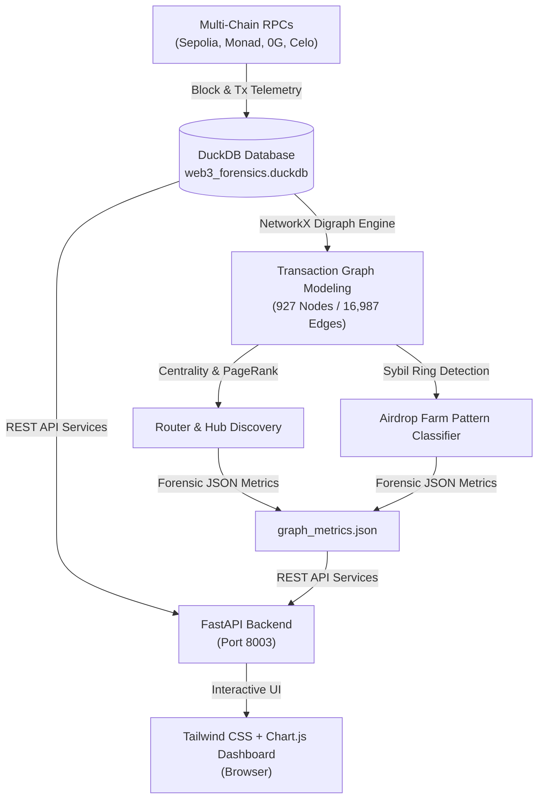

# ⛓️ Web3 On-Chain & Gas Forensics (DeFi, L2s & Layer-1s)

[](https://python.org)
[](https://web3py.readthedocs.io)
[](https://duckdb.org)
[](https://networkx.org)
[](https://fastapi.tiangolo.com)
[](LICENSE)

Plataforma de inteligência e auditoria forense on-chain para monitoramento de consumo de gás (EIP-1559), análise topológica de transações via grafos (NetworkX) e detecção de clusters maliciosos / anomalias de **Airdrop Farming Sybil** através de múltiplas redes EVM (**Ethereum Sepolia, Monad Testnet, 0G Galileo e Celo**).

---

## 🚀 Capacidades Forenses

- **Análise Volumétrica & Saturação EIP-1559:** Avaliação de queima de gás (burned base fee), limite de blocos e picos de demanda em tempo real em 25.000 transações e 1.200 blocos.
- **Topologia de Grafo com NetworkX:** Mapeamento de 927 carteiras e 16.987 arestas direcionadas com cálculo de **PageRank e Centralidade de Grau** para identificar pools de liquidez e roteadores DeFi.
- **Detecção de Anomalias & Sybil Rings:** Algoritmo forense para identificar anéis coordenados de micro-transações direcionados a farming artificial de airdrops.
- **Auditor Interativo de Carteiras:** Digite qualquer endereço de carteira (ex.: sua carteira Sepolia) para obter o cálculo imediato de escore de risco e classificação de nó.
- **Sem Streamlit / 100% FastAPI + Tailwind CSS:** Interface limpa, responsiva e de alta performance.
- **Execução em 1 Clique (`iniciar.bat`):** Script para Windows que configura e inicia o projeto automaticamente na porta `8003`.

---

## 📊 Arquitetura Forense



---

## 🛠️ Como Executar

### 1. Execução no Windows (1 Clique)
Dê um duplo clique no arquivo **`iniciar.bat`** ou execute:
```bat
iniciar.bat
```
O script cuidará das dependências, minerará a telemetria no DuckDB, calculará o grafo NetworkX e abrirá automaticamente o navegador em `http://127.0.0.1:8003`.

### 2. Execução Manual
```bash
pip install -r requirements.txt
python data/pipeline.py
python forensics/graph_analysis.py
python -m uvicorn app.main:app --host 127.0.0.1 --port 8003
```

---

## 👨‍💻 Autor

- **Tássio Sales** - [@TassioSales](https://github.com/TassioSales)
- Inteligência de dados on-chain e segurança de ecossistemas descentralizados.
